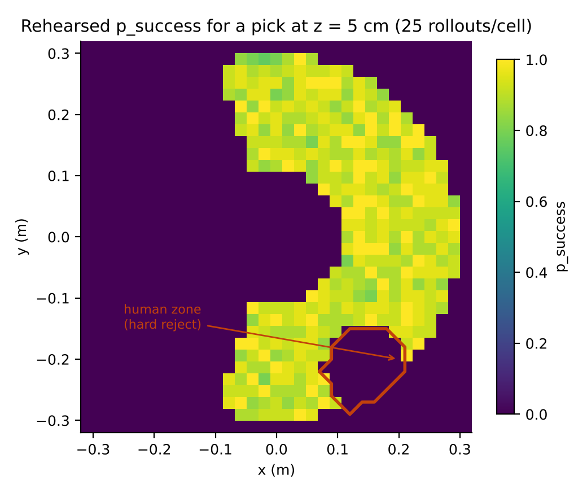
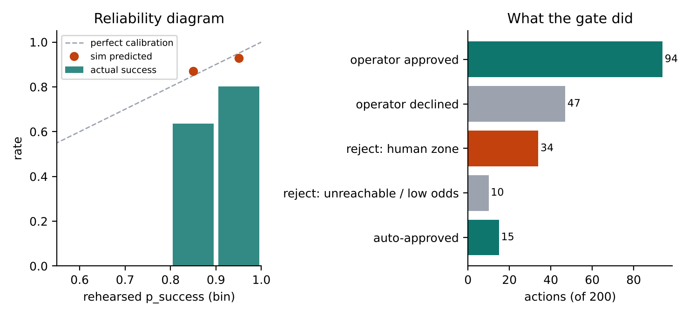
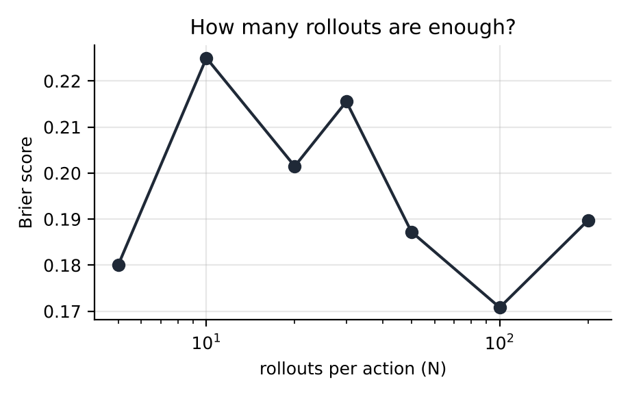

# Operator Layer: notes on how I built it

Mohamed Harhash, October 2026. Covers v0.2.0.

I run a SO-101 arm at home with LeRobot. My day job is software quality for surgical robots at J&J MedTech. This project came out of the gap between those two things, and these notes explain what I built and the reasoning behind each part. They are written for someone who wants to understand the design, not just run it. If you want to run it, the README is shorter.

## The problem

At work, a robot arm doesn't move until there is a verification record saying that class of motion is safe. That's the whole job, really. At home, I was running a learned policy on the SO-101 and realized there was nothing like that. The policy is a neural network. Run it twice on the same scene and you get two different motions. There's no test I can write that says "this is safe," because the honest description of what the policy does is a probability distribution, and you can't put a probability in a pass/fail column.

The usual fix is a safety monitor that watches the arm and stops it when something looks wrong. I didn't like that because it only acts after the arm is already in the wrong place. What I'm used to is deciding before the motion, not during it.

So the question I set myself was: what's the smallest thing I can build that gives a learned policy a "prove it first" step, without making research slower?

## What I built

A gate. It sits between the policy and the robot. For every action the policy proposes, the gate runs that action fifty times in a simulator, looks at the distribution of outcomes, and decides: approve, reject, or ask a person. If the action runs, the gate records what the real robot actually did. Over time that gives me a measurement of how much to trust the simulator, which is a number I didn't have before and badly wanted.

```
policy -> ProposedAction -> [rehearse 50x] -> RehearsalResult -> [decide] -> Decision -> robot -> Outcome
                                                                                             |
                                 calibration: was the predicted p_success right? <-----------+
```

The repo has four parts:

- `core/` is the logic. Plain Python with numpy and pydantic. No ROS.
- `ros2_ws/src/operator_layer_msgs` is the four message types.
- `ros2_ws/src/operator_layer_ros` is six small ROS 2 nodes that move messages in and out of the core.
- `docker/` and `.github/` build and test all of it for x86 and ARM.

## Keeping the logic out of ROS

This was the first decision and I think it's the most important one.

Everything that decides anything lives in `core/`. The ROS nodes don't contain logic; they take a message, call a core function, publish the result. I did this for a practical reason first: the core tests run in about a third of a second with nothing installed but Python, so I run them every time I save a file. If the tests needed a ROS install and a DDS daemon I'd run them once a day and find bugs a day late.

There's a second reason that comes from work. When I review safety-relevant code I want to be able to read all of it in one sitting. If the gate logic were spread across five ROS nodes with callbacks and timers, that wouldn't be possible. With it in one folder, it is.

And a third reason, which matters in a lab setting. If the reasoning team and the perception team and the simulation team all have to import my package to work with the gate, every change I make is their problem. If they only have to publish and subscribe to a message, I can rewrite the inside as much as I want.

## The messages

I wrote the four messages before I wrote any logic. This is the one people look at most, the rehearsal result:

```
std_msgs/Header header
string action_id
uint32 n_rollouts
float64 p_success         # fraction of rollouts that succeeded
float64 p_risk            # fraction with any risk event
string[] risk_classes     # parallel arrays: histogram of risk class -> count
uint32[] risk_counts
float64 mean_final_error
string sim_backend
operator_layer_msgs/RolloutResult[] rollouts   # empty unless keep_rollouts is set
```

Every message carries `action_id`. The logger reconstructs an episode by matching ids across the four messages. I never match by timestamp. I've debugged enough test data pipelines where a result got attached to the wrong run because two things happened close together in time, and it's the kind of bug that goes unnoticed for weeks. Matching on an id that was minted once and copied forward can't do that.

The messages are in their own package, separate from the nodes. Interface packages should change rarely. If they live next to node code, every small change to a node forces everyone who depends on the messages to rebuild.

The risk histogram is two parallel arrays because ROS 2 message definitions don't have a map type. The conversion layer turns them back into a dict. Not pretty, but explicit.

## The simulator

The rehearsal needs a simulator. I wrote a kinematic model of the SO-101: five joints with limits, approximate link lengths, Gaussian noise on each joint and on the final gripper position, a grasp model where success falls off with misalignment, and a region I call the human zone that the arm must never enter.

It is not a physics engine. There's no contact, no dynamics. I considered starting with MuJoCo and decided against it. Until the rest of the pipeline existed, a better simulator would just have given me more precise numbers I couldn't do anything with. What I needed was for the odds to behave like real odds: worse near the edge of reach, different failure modes in different places. The kinematic model does that, and it runs fifty rollouts in about five milliseconds.



*What the simulator thinks the odds of a successful pick are at each point in the workspace, 25 rollouts per cell. Reachable area is a ring. Odds get worse toward the outer edge because joint noise is amplified by the longer lever arm. The outlined region is the human zone.*

The noise parameters are hand-set for now. I don't intend to keep them. They're the thing the real-world data is supposed to fit later. The sim is a model with parameters to identify, which is how I was trained to think about any model.

The gate only sees the simulator through one method, `rollout(action, rng) -> RolloutResult`, so swapping in MuJoCo later doesn't touch anything else.

## The rehearser

Run the action N times, summarize. N is 50 by default. The random generator is seeded.

```python
def rehearse(self, action: ProposedAction) -> RehearsalResult:
    rollouts = [self.backend.rollout(action, self.rng) for _ in range(self.n)]
    n_ok = sum(r.success for r in rollouts)
    n_risk = sum(r.risk.value != "none" for r in rollouts)
    hist = Counter(r.risk.value for r in rollouts if r.risk.value != "none")
    ...
```

The seed matters. When the gate makes a decision that looks wrong, I can replay the exact fifty rollouts and see why. A result I can't reproduce isn't evidence; that's a habit from regulated testing and I kept it.

Why 50? It was a round number. I measured it later; see the results section.

## The gate

Four rules, in order:

```
1. Any rollout hitting a hard risk class (human proximity by default) -> REJECT
2. p_success >= approve_threshold and p_risk <= max_risk              -> APPROVE
3. p_success <  reject_threshold                                       -> REJECT
4. otherwise                                                           -> ASK_OPERATOR
```

Defaults: approve at 95% success and under 5% risk, reject under 60%, ask a person in between. Hard risks come first and are absolute. If one rollout out of fifty entered the human zone, the policy wanted to go somewhere it must never go, and no success rate changes that.

The whole thing is about twenty lines. I kept it that small deliberately. On a surgical program the most important document is the one that says exactly when the robot can act without a human. This file is that document, and I want a reviewer to get through it in a couple of minutes. The thresholds themselves are in `config/gate.yaml`, not in the code, so changing when the arm moves on its own is a one-line diff that someone reviews and that shows up in git history. A year from now, if someone asks why the threshold is what it is, the answer is in the log.

## The episode store

Every action becomes a line in a JSONL file: the proposal, the rehearsal odds, the decision, and the outcome if it ran. Rejected actions get written immediately. Approved ones stay pending until the outcome arrives.

I chose a text file over a database. It survives a crash mid-write, it diffs in git, and pandas reads it directly. When more than one robot is writing at the same time I'll move to Postgres. Not before.

From the file I compute three numbers:

- The gap: mean predicted success minus actual success. Positive means the sim is overconfident, which is the dangerous direction.
- Brier score: mean of (predicted − actual)². Zero is perfect, 0.25 is a coin flip.
- Calibration error per probability bin, which tells me where in the range the sim is wrong, not just how much.

I didn't invent a metric. These are the standard way to score a probabilistic forecast; weather services use the Brier score. One thing I learned building the regression platform at work is that a metric people already trust gets acted on, and a clever one gets argued about.

## The ROS 2 nodes

Six of them.

| Node | What it does |
|---|---|
| `rehearsal_gate` | Subscribes to proposals, rehearses, decides. Holds a wait-list for ASK_OPERATOR with a timeout; timeout means reject. |
| `scripted_policy` | Proposes pick-and-place actions at a fixed rate. Stand-in for a learned policy. |
| `auto_operator` | Answers grey-zone cases, approving above 0.85. Stand-in for a human console. |
| `sim_robot` | Executes approved actions in a second sim with noisier parameters. Stand-in for reality. |
| `so101_bridge` | Executes on the real arm through LeRobot. Only starts if `OL_ROBOT=so101` is set. |
| `outcome_logger` | Joins the four messages by id into episode rows. Prints the calibration summary every 20 episodes. |

A few ROS 2 specifics worth explaining.

Quality of service. ROS 2 runs on DDS and every topic has a delivery policy you have to pick. Decisions and outcomes use RELIABLE with TRANSIENT_LOCAL durability, which means the publisher keeps the last 50 messages and hands them to any subscriber that joins late. I did that because if the logger starts a second after the gate and misses a decision, that episode never closes, and the data is wrong in a way that's hard to see. Rehearsal results are RELIABLE but VOLATILE: they can carry fifty rollout payloads each and arrive at the policy rate, so retaining them would be memory for nothing.

Parameters. All of them are in one YAML file loaded by every node. There's one place to look.

The hardware interlock. `so101_bridge` refuses to start unless `OL_ROBOT=so101` is in the environment. I want it to be impossible to move a real arm by launching the wrong file. Everything at work that can move hardware has its own separate enable, and this is the same idea.

There's also an integration test under `launch_testing`. It brings up all five sim nodes over real DDS, runs 30 actions, and checks that every proposal got a decision, every approval got an outcome with the same id, and the human-zone reject fired at least once. It runs in CI on Humble and Jazzy.

## Results

The terminal demo (`python -m operator_layer_core.demo`) proposes picks across the workspace, with every tenth one inside the human zone. A short run:

```
id           p_succ p_risk  verdict       real    reason
141b290b3040   0.88   0.12  approve       ok      operator approved at p=0.88
f73f12242291   0.82   0.18  reject        -       operator declined at p=0.82
8ccab0e79a43   0.00   1.00  reject        -       hard risk human_proximity seen in 50/50 rollouts
2f9f67c97937   0.90   0.10  approve       ok      operator approved at p=0.90
c7cf3cdb897e   0.00   1.00  reject        -       p_success=0.00 < 0.6
fe20238773d3   0.96   0.04  approve       ok      p_success=0.96 >= 0.95, p_risk=0.04
eca221a0fea2   0.88   0.12  approve       object_drop  operator approved at p=0.88
```

The last row is worth pointing at. The operator approved at 88% and the real robot dropped the object. The sim had said there was about a 12% chance of exactly that. Nothing went wrong; that row is a calibration data point.

Over 200 actions, the sim predicted 91% success on the actions that ran and reality delivered 75%.



*Left: dots are what the sim predicted per bin, bars are what actually happened, dashed line is perfect calibration. Right: how the 200 proposals were dispositioned.*

```
executed episodes : 109
predicted success : 0.911
actual success    : 0.752   (sim-to-real gap +0.159)
brier score       : 0.2072
ECE (10 bins)     : 0.1589

bin        n   predicted  actual
0.8-0.9    33   0.870     0.636
0.9-1.0    76   0.929     0.803
```

I set "reality" to be noisier than the sim on purpose, so I'd know the pipeline catches a bad simulator. It does. The more useful detail is where the sim is wrong: the overconfidence is bigger in the 0.8–0.9 bin than in the 0.9–1.0 bin. That's the grey zone, where the gate is asking a person to decide. So that's where calibration effort should go first.

Then I asked whether more rollouts would help.



*Brier score against rollouts per action, 150 actions each.*

It's flat. More rollouts give a sharper estimate of what the sim thinks, but the sim's bias doesn't move. Rollout count controls variance; calibration controls bias. They're different problems. This is the result I'd show someone who asked why the episode store exists at all. It means the budget should go into real data and sim fidelity, and that a faster physics engine running more samples wouldn't fix anything.

## Things that broke

These are more honest than the diagrams.

The first time I ran it, every action was rejected as unreachable. My joint limits were tighter than the configurations my own IK was returning (elbow at −2.1 rad against a ±1.6 limit). So the simulator flagged every pose as out of limits and the gate rejected everything with total confidence. One-line fix. The lesson was to check the simulator against its own geometry before trusting any rollout, and there's now a forward/inverse kinematics round-trip test at the top of the test file.

Then nothing could be auto-approved. The sim capped a well-aligned grasp at 92% and the gate auto-approved at 95%. I wrote those two numbers on different days. They never met. The gate thresholds and the sim's ceiling are one design decision, and the config file now has a comment saying so.

Then I found the rule that was secretly deciding everything. For a pick, every failure is an object drop, and an object drop is a risk class. So `p_risk = 1 − p_success`, and `max_risk`, not `approve_threshold`, was the binding constraint on every grey-zone case. Rules that look independent interact through the data. The gate tests now exercise the rules as a set, including a case that asserts a high-success-but-risky action is not auto-approved.

## Docker and CI

One Dockerfile builds for x86 and ARM, because the `ros:humble` base image is published for both. Two stages, so the runtime image doesn't carry build tools. I copy `core/` into the image before `ros2_ws/` because it changes less often, which keeps the Docker layer cache warm.

CI runs three jobs in sequence. First the core tests on Python 3.10 and 3.12, with ruff. Then `colcon build` and `colcon test`, including the launch test, inside the official Humble and Jazzy containers. Then a multi-arch image build with buildx. The ARM build is in CI specifically because it's the one that breaks first, usually when someone adds a wheel that only ships for x86.

The container defaults to `OL_ROBOT=sim`. Nothing in it can touch hardware unless that's overridden.

## What's not done

The rehearsal sim is kinematic with hand-set noise, and the calibration numbers above are sim-against-sim. The first real-arm run is the next milestone and will produce the first honest row in `docs/sim-to-real.md`.

The LeRobot calls in `so101_bridge` are stubs. They're isolated and marked. Deciding whether a real pick succeeded needs a camera check I haven't written.

The operator is a threshold. A console that shows the fifty rollouts and lets a person approve or reject is on the roadmap.

I built and tested the core directly. The ROS build runs in CI rather than on a local install, so I expect the first push to turn up a small environment issue or two.

Next, in order: 100 picks on the real SO-101 over a 3×3 grid; fit the sim's noise parameters to that data; a MuJoCo backend behind the same `rollout()` interface; a web console that exports operator corrections as a training dataset.
